# Elevator Control System - Design Documentation

## Overview

This document provides visual representations of the elevator control system design using state machine diagrams and component architecture diagrams.

---

## Part 1: Elevator State Machine

### Main State Machine Diagram

The elevator follows a sophisticated state machine with 11 distinct states and smooth acceleration/deceleration transitions.

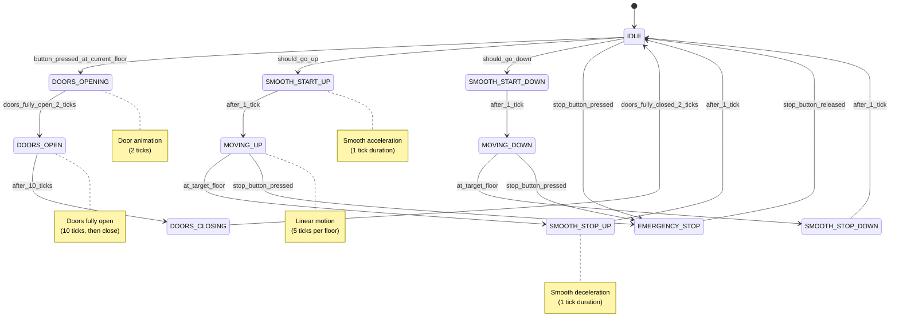

### State Descriptions

| State | Purpose | Duration | Next State |
|-------|---------|----------|-----------|
| **IDLE** | Waiting at floor, doors closed | ∞ | Next floor request |
| **SMOOTH_START_UP** | Acceleration upward | 1 tick | MOVING_UP |
| **MOVING_UP** | Moving upward | 5 ticks/floor | SMOOTH_STOP_UP |
| **SMOOTH_STOP_UP** | Deceleration upward | 1 tick | IDLE |
| **SMOOTH_START_DOWN** | Acceleration downward | 1 tick | MOVING_DOWN |
| **MOVING_DOWN** | Moving downward | 5 ticks/floor | SMOOTH_STOP_DOWN |
| **SMOOTH_STOP_DOWN** | Deceleration downward | 1 tick | IDLE |
| **DOORS_OPENING** | Opening animation | 2 ticks | DOORS_OPEN |
| **DOORS_OPEN** | Fully open at floor | 10 ticks | DOORS_CLOSING |
| **DOORS_CLOSING** | Closing animation | 2 ticks | IDLE |
| **EMERGENCY_STOP** | Emergency stop active | ∞ | IDLE (on release) |

---

## Part 2: Button Press Logic Flow

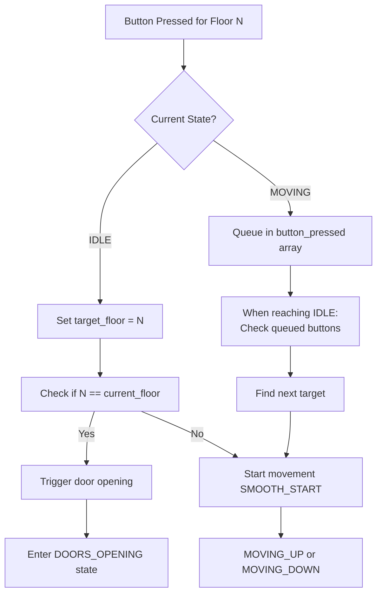

---

## Part 3: Movement Timing Diagram

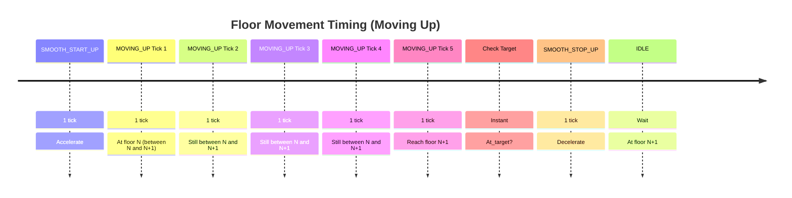

---

## Part 4: Component Architecture Diagram

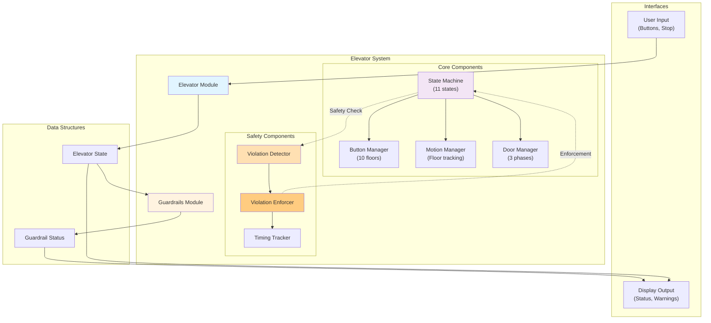

---

## Part 5: Guardrails Architecture

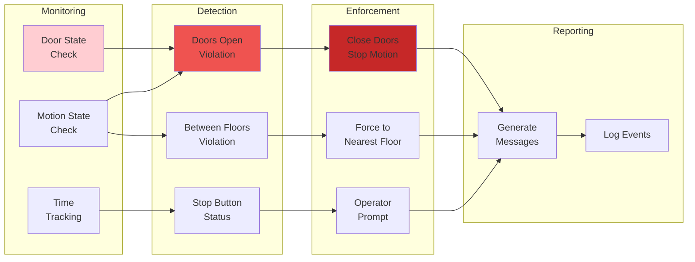

---

## Part 6: Violation Detection Logic

### Doors Open While Moving Violation

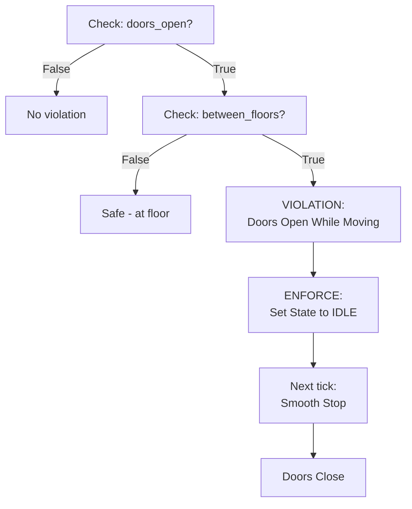

### Emergency Stop Between Floors Violation

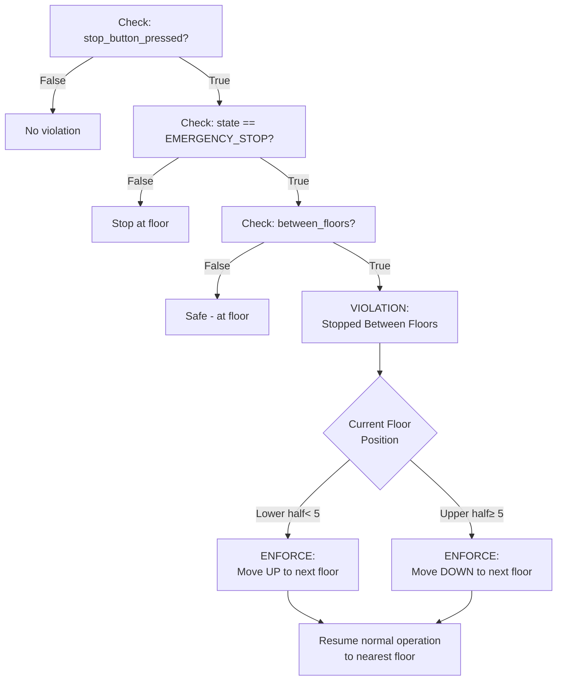

---

## Part 7: System Data Flow

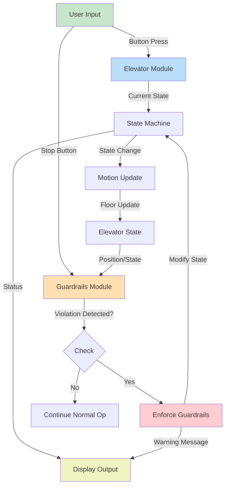

---

## Part 8: Tick-by-Tick Operation

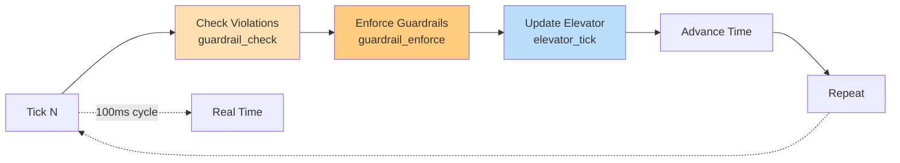

---

## Part 9: Safety Guarantee Layers

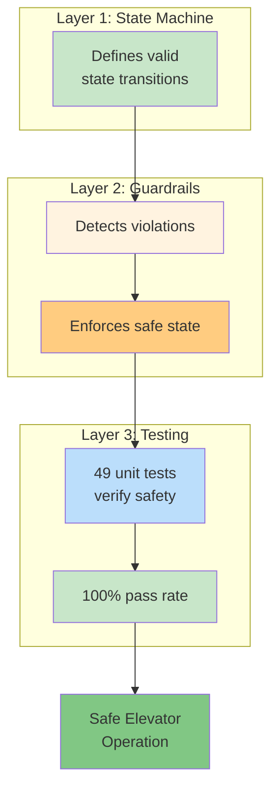

---

## Part 10: Emergency Stop Sequence

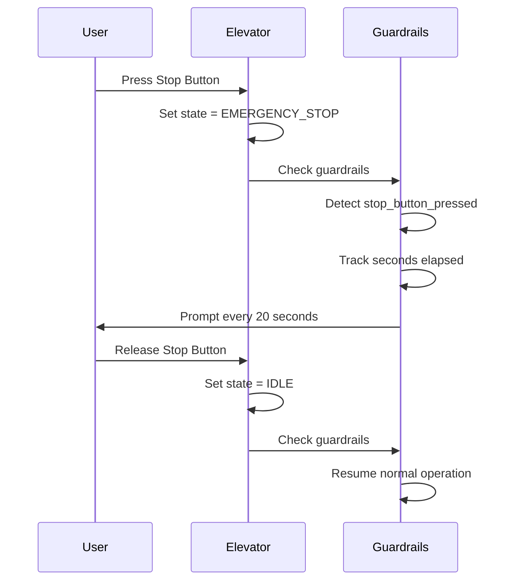

---

## Part 11: Door Operation Sequence

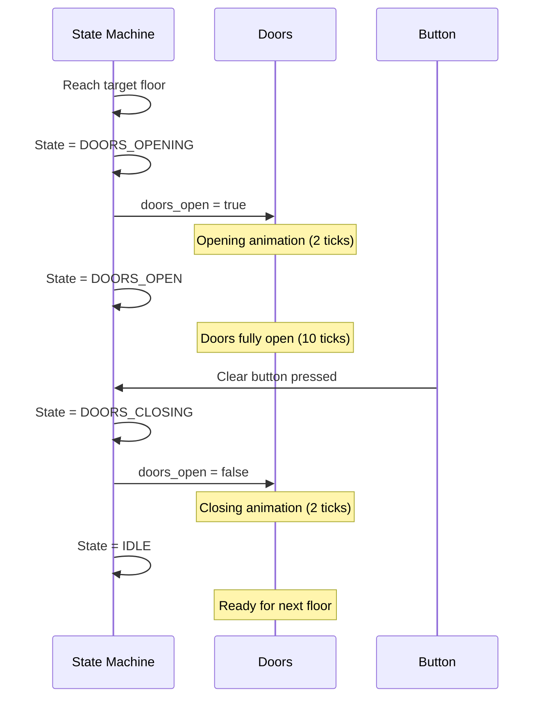

---

## Part 12: Between Floors State Definitions

```mermaid
graph TB
    subgraph "BETWEEN FLOORS STATES"
        A["SMOOTH_START_UP"]
        B["SMOOTH_START_DOWN"]
        C["MOVING_UP"]
        D["MOVING_DOWN"]
        E["SMOOTH_STOP_UP"]
        F["SMOOTH_STOP_DOWN"]
    end
    
    subgraph "AT FLOOR STATES"
        G["IDLE"]
        H["DOORS_OPENING"]
        I["DOORS_OPEN"]
        J["DOORS_CLOSING"]
    end
    
    subgraph "SPECIAL STATES"
        K["EMERGENCY_STOP"]
    end
    
    note right of A
        Safe for motion violations
    end note
    
    note right of G
        Safe for door operations
    end note
    
    style A fill:#ffcccc
    style B fill:#ffcccc
    style C fill:#ffcccc
    style D fill:#ffcccc
    style E fill:#ffcccc
    style F fill:#ffcccc
    style G fill:#ccffcc
    style H fill:#ccffcc
    style I fill:#ccffcc
    style J fill:#ccffcc
```

---

## Key Design Principles

### 1. **State Machine Foundation**
- Clear, finite states with well-defined transitions
- Smooth motion with acceleration/deceleration phases
- Atomic state changes (no intermediate inconsistencies)

### 2. **Safety Through Layering**
- State machine ensures valid operations
- Guardrails catch edge cases and violations
- Testing verifies all scenarios

### 3. **Deterministic Behavior**
- All actions based on current state and inputs
- No race conditions or timing-dependent logic
- Predictable motion (constant ticks per floor)

### 4. **Separation of Concerns**
- Elevator module: Normal operation
- Guardrails module: Safety enforcement
- Easy to test, maintain, and extend

### 5. **Reactive Safety**
- Guardrails check on every tick
- Immediate enforcement when violations detected
- No prevention - only detection and correction

---

## Related Documentation

- [GUARDRAILS.md](GUARDRAILS.md) - Detailed guardrails specification
- [STATE_MACHINE.md](STATE_MACHINE.md) - State machine detailed design
- [TESTING.md](TESTING.md) - Test coverage and verification
- [test_simple.c](test_simple.c) - Test implementation

---

## References

- **State Machine Pattern**: Gang of Four Design Patterns
- **Safety Systems**: Defense-in-depth approach
- **Elevator Control**: ASME A17.1 Standard (simplified)
