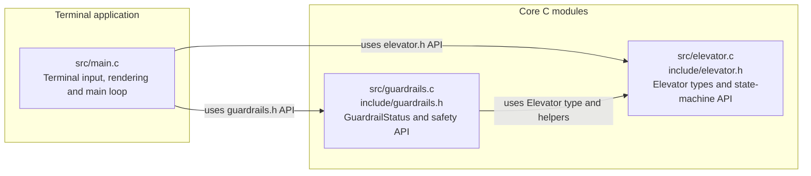
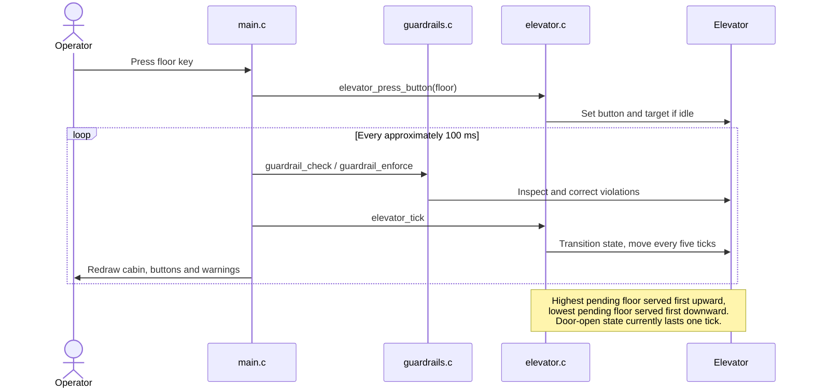
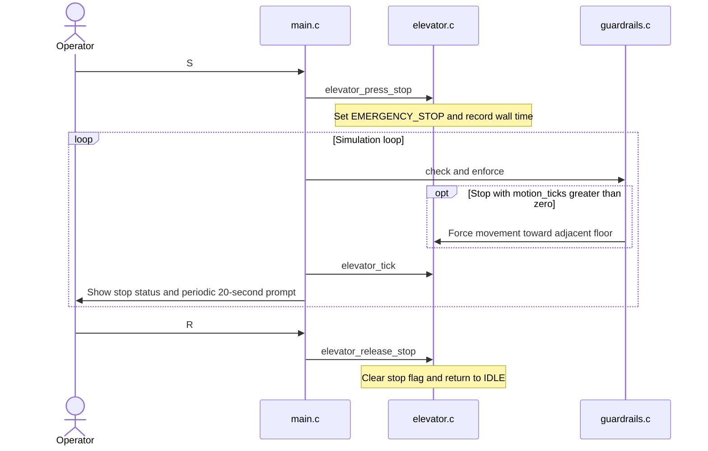

# Before: terminal elevator

Baseline captured on 2026-10-20 before implementation changes. Source: `src/main.c`, `src/elevator.c`, `src/guardrails.c` and their headers.

## Architecture

## Sequence: request and travel

## Sequence: emergency stop and resume

## Baseline limits

There is one elevator, ten floors (0–9), and one shared set of floor requests. There are no passenger identities, boarding rules, capacity, directional hall calls, network API, or persistence. Time advances in the terminal loop. `elevator_get_position` reports integer floors. This is an educational simulation, not a physical elevator controller.
