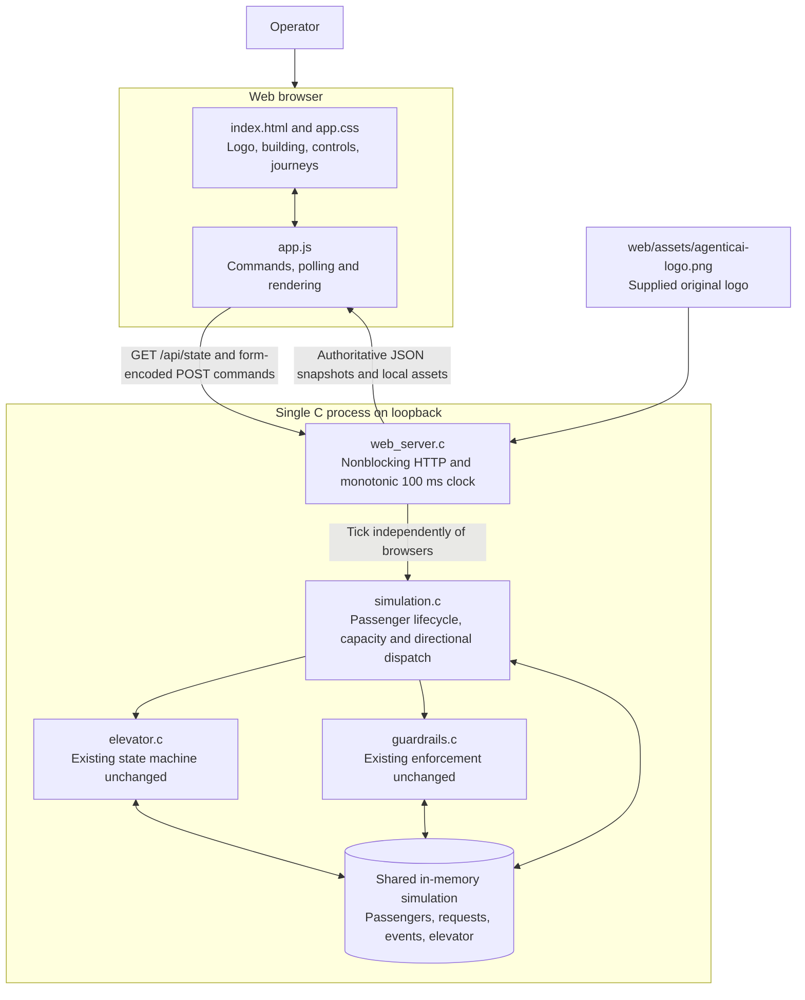
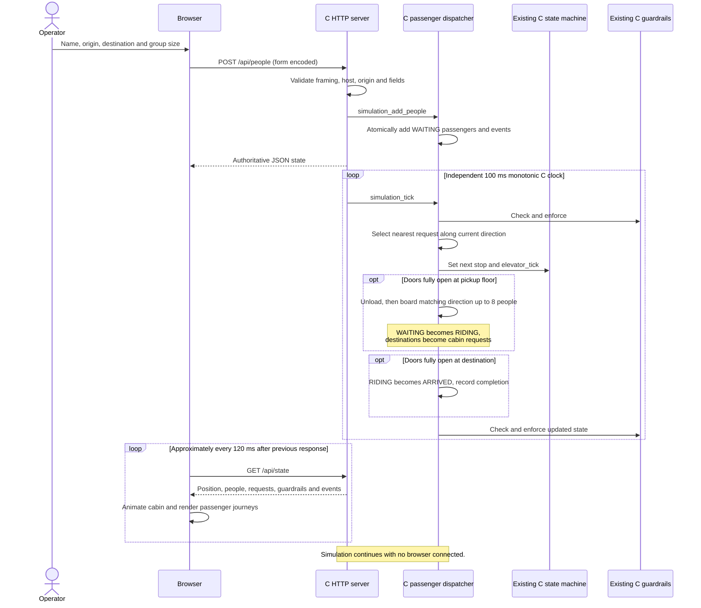
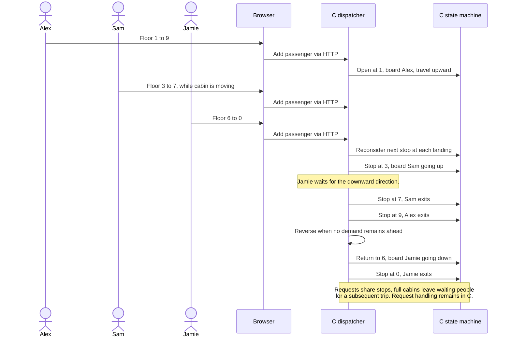
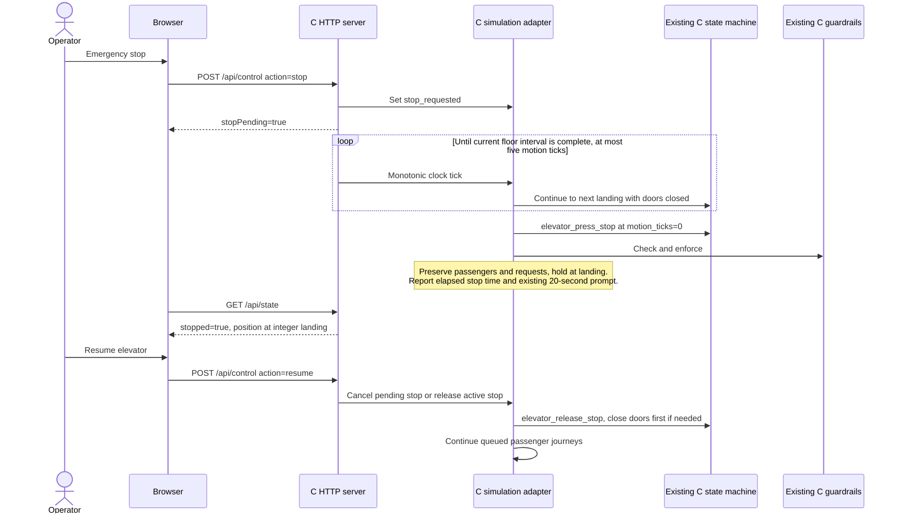

# After: Elevator Lab web interface with C runtime

Implemented on 2026-10-20. Compare with [the baseline](01-before.md). Open [the diagram gallery](diagrams.html) for rendered diagrams; individual SVG and editable Mermaid exports are in `diagrams/`.

## Architecture

## Sequence: add passengers and complete a shared trip

## Sequence: new calls while moving and direction reversal

## Sequence: stop, hold and resume

## Decisions and scope

| Concern | Before | After |
| --- | --- | --- |
| User interface | Keyboard and ASCII terminal | Responsive HTML/CSS/JavaScript, supplied agenticAI logo |
| Runtime authority | C terminal loop | C server clock, unaffected by browser refresh or slow clients |
| Elevator and guardrails | `elevator.c`, `guardrails.c` | Same files, unchanged |
| Requests | One undifferentiated button array, farthest destination first | C adapter merges manual calls, waiting origins, and onboard destinations; selects intermediate stops |
| People | None | Named passengers, origin, destination, direction, waiting/riding/arrived lifecycle |
| Capacity | None | Eight riders; excess passengers remain waiting |
| Doors | One core tick fully open | Adapter holds open for about two seconds; unloads before boarding |
| Stop | Core stop can invoke between-floor correction | Adapter finishes the current floor interval before latching the existing stop API |
| State transport | Terminal redraw | Same-origin JSON snapshots; form-encoded commands |
| Storage | In memory | In memory; shared across browser clients; reset/restart clears journeys |

The C adapter supplies one selected button to the existing core, so the core's original farthest-floor policy cannot skip the chosen intermediate stop. Dispatch continues in the current direction until there is no request ahead, then reverses. Opposite-direction passengers can remain waiting at a visited floor. A full cabin ignores pickup-only requests until space is available. Finite traffic is tested to completion; an infinite stream of new requests has no bounded waiting-time guarantee.

The local service binds to IPv4 loopback, accepts only the configured localhost/127.0.0.1 Host, rejects cross-origin browser commands, serves an explicit asset allowlist, caps input and simultaneous clients, and closes stalled connections. It is an educational local simulator, without authentication, persistence, TLS, hardware integration, or production elevator certification. The session retains at most 160 passenger records and the most recent 48 events (20 displayed). Node and Playwright are test tools only; neither is part of the running backend.
