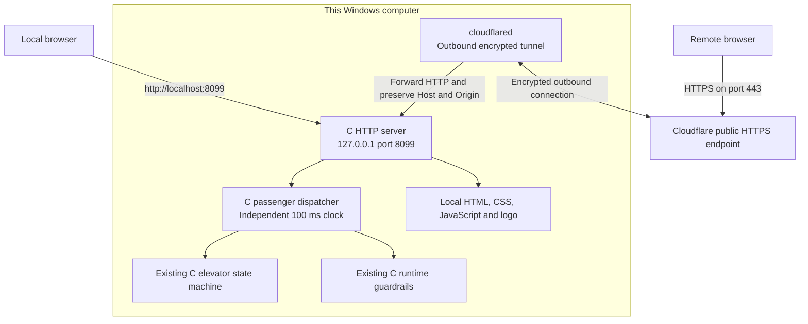
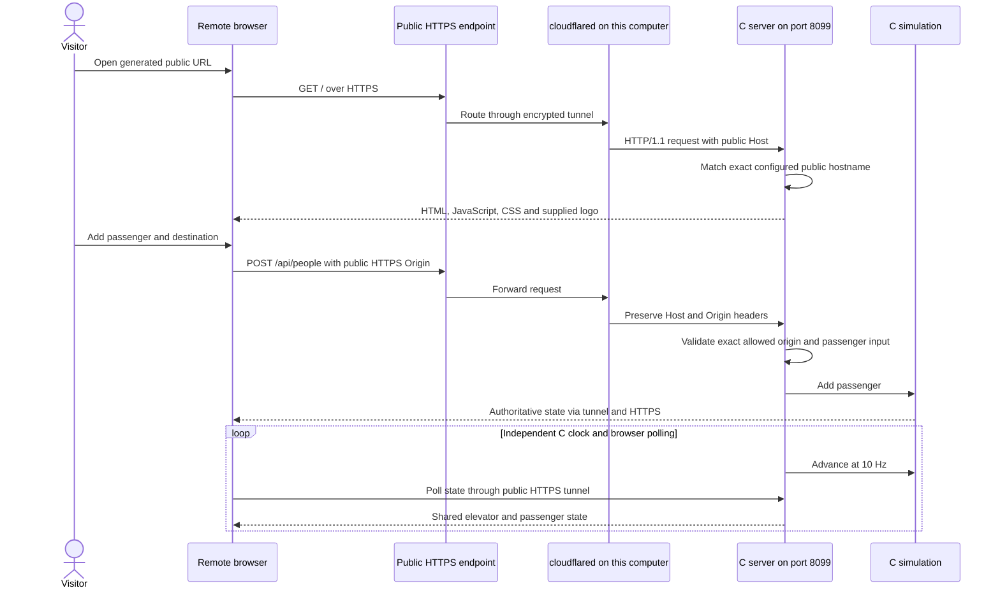

# Internet access: HTTPS tunnel to the C backend

Added on 2026-10-20 after the local web interface. The original [before](01-before.md) and [after](02-after.md) documents remain snapshots of those stages. The default local port is now 8099. Public access adds a transport process; elevator state and passenger logic still run in C.

## Architecture

## Sequence: operate the simulator through the internet

`run-public.ps1` checks an exclusive bind on the requested port, compiles a separate C executable, verifies a pinned official cloudflared binary's SHA-256, starts hidden background processes, discovers the assigned HTTPS origin, and starts C with that exact origin allowed. Both local and public HTTP checks must pass before the session is recorded. Public DNS is used to verify newly assigned addresses if the local DNS cache has not resolved them yet; machine DNS settings remain unchanged.

`build/public/session.json` records the current URL, port, process IDs, executable paths, and process start times. `stop-public.ps1` checks process identity before stopping the session. Logs and state remain under ignored `build/`. Other services and firewall rules are not changed.

This deployment uses a temporary Cloudflare Quick Tunnel, not an always-on hosted server. The URL works while this computer is awake, online, and both background processes are running. Restarting creates a different hostname and a fresh in-memory simulation. All visitors share the same elevator and can operate its controls. Stable hostnames and availability independent of this computer require a named tunnel or a hosted C server. See [Cloudflare Quick Tunnel behavior and limitations](https://developers.cloudflare.com/tunnel/get-started/quick-tunnels/).
