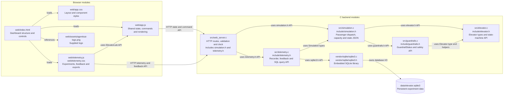
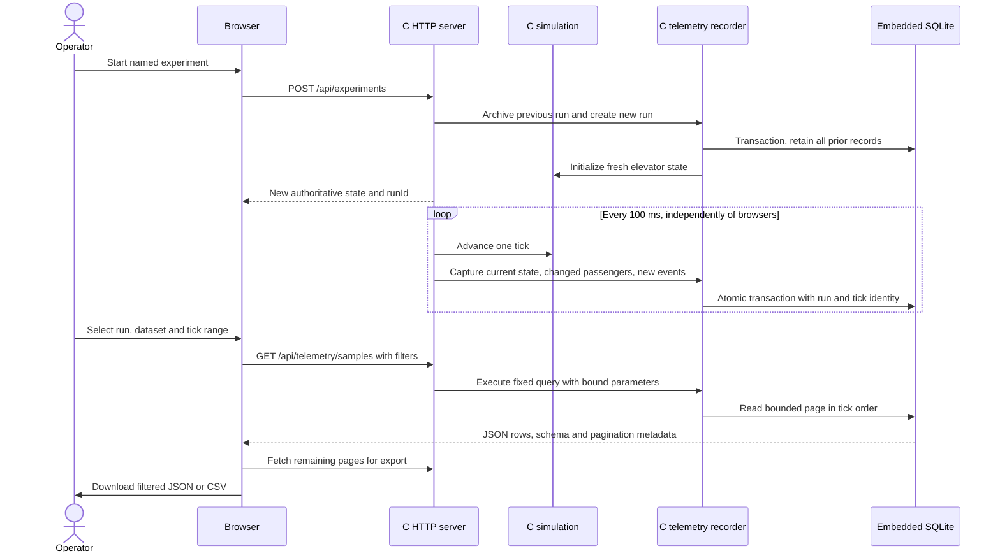
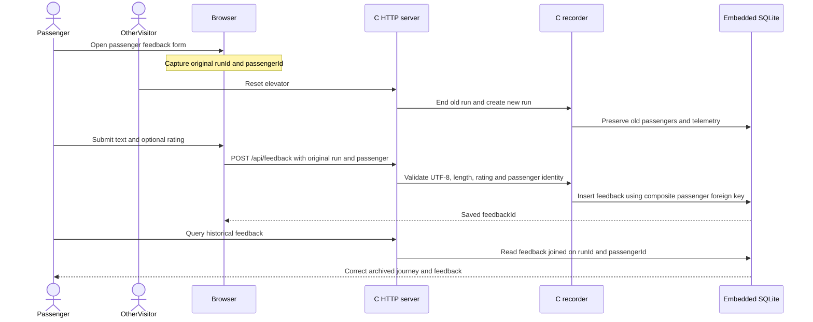

# Telemetry and feedback: persistent experiments inside C

Added after the `web1` checkpoint. [The web-interface snapshot](02-after.md) and [public-access snapshot](03-public-access.md) document the previous architecture. Live state previously existed only in memory and the display event ring. The new embedded recorder preserves experimental data independently of browser polling.

## Architecture

## Sequence: record and query an experiment

## Sequence: feedback survives a concurrent reset

The database uses WAL and full synchronization, one capture per tick plus immediate captures after commands, prepared statements for writes, and bounded fixed read queries. Startup creates a new run; reset/restart do not delete history. Failed capture attempts and event loss are observable. The single-recorder ownership lock permits independent SQLite readers. Full schema, API, data-quality semantics and experimentation examples are documented in [TELEMETRY.md](../TELEMETRY.md).
