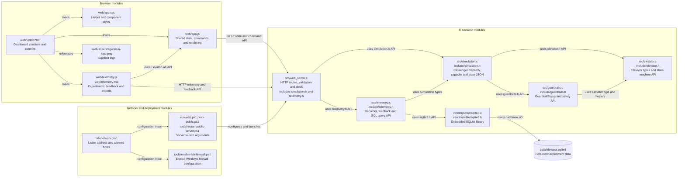
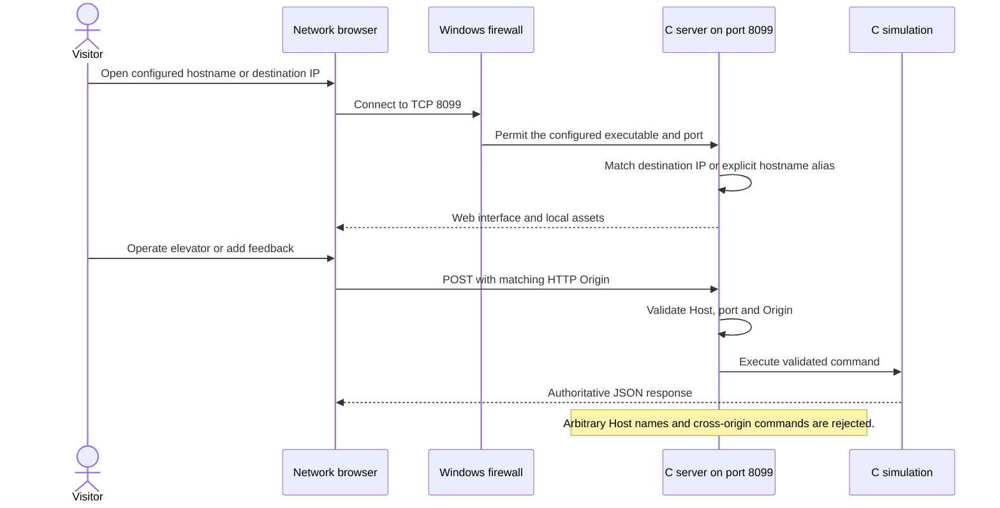

# Direct network access alongside the public tunnel

Recorded from the implemented network-access extension on 2026-10-20. This snapshot fills the deployment detail between [embedded telemetry](04-telemetry.md) and the evolution viewer. The local default remains loopback; network exposure is explicit.

## Architecture

## Sequence: a direct network request

The `--listen-address` option defaults to `127.0.0.1`; `0.0.0.0` enables direct IPv4 network connections. Repeated `--allowed-host` arguments allow explicit DNS aliases on the configured port. Destination-IP checks do not accept arbitrary Host values. The public tunnel remains available, and browser commands must match their respective HTTP or HTTPS origin. Upstream routers and institutional firewalls can still restrict inbound reachability.

The PowerShell startup scripts preserve listen addresses and hostname aliases. The firewall helper is separate and requires administrator rights. This documentation step does not change firewall rules or invent network reachability beyond the tested server behavior. Telemetry, feedback and all elevator behavior remain in C.
