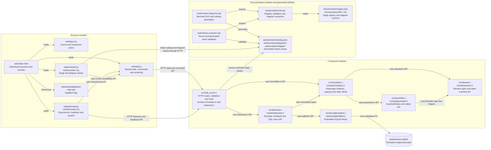
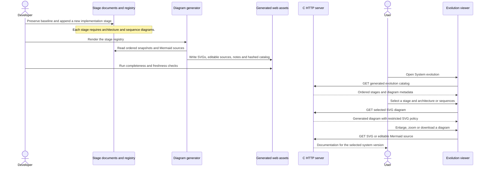

# Evolution diagrams in the web interface

The previous stages were preserved as Markdown, Mermaid, SVG exports and an offline gallery. This step adds their history to the live web page and establishes a repeatable workflow for subsequent implementation steps. Earlier stage files remain snapshots of their own versions.

## Architecture

## Sequence: publish and inspect the next system stage

The web viewer consumes one generated catalog rather than duplicating the stage list. It provides stage descriptions, architecture/sequence filters, full-size viewing, zoom, and source downloads. The C server serves only documentation assets with constrained names and extensions inside the generated documentation directories; repository files and the SQLite database remain unavailable through these routes.

`AGENTS.md` records the user's ongoing requirement. Add new stages to `docs/evolution/stages.json`, include both diagram kinds, regenerate, verify, and publish the result with each meaningful implementation step. `tools/check-evolution.mjs` checks the source hashes, diagram completeness and mirrored assets without requiring Mermaid or a browser. Rendering tools are development dependencies only; the deployed backend remains C and the viewer needs no external runtime service.
