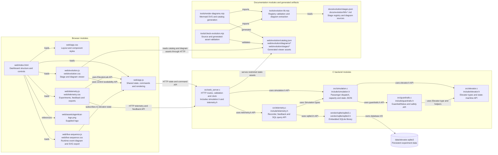
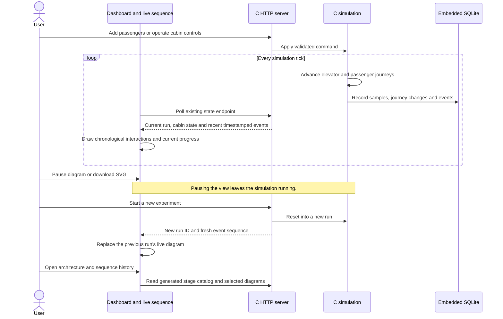
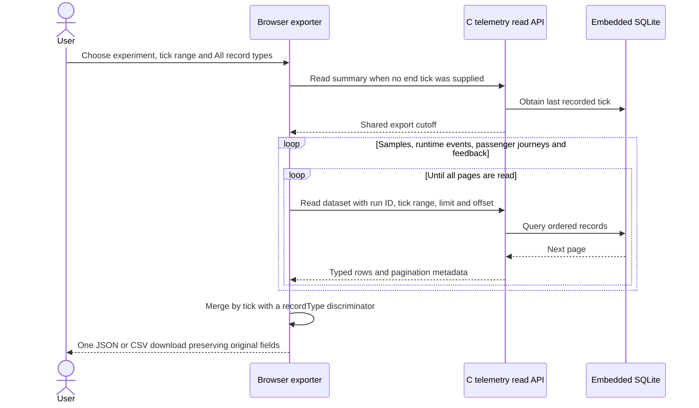

# Live run sequences and complete exports

Stage 06 is the preserved baseline: six documented stages were available through the evolution timeline, and telemetry exports contained one selected dataset. This stage makes diagrams visible from the dashboard, adds a live sequence of the current run, and allows one export to include all recorded data kinds. The C runtime, embedded SQLite schema and existing telemetry APIs remain the system of record.

## Architecture

## Sequence: follow the current run

## Sequence: export every recorded data kind

The live diagram uses the actual recent runtime event buffer, ordered by tick and event ID. It identifies passenger interactions against the structured passenger records; other messages remain runtime observations. It shows the latest 20 interactions, clearly identifies the run and visible window, and does not claim to show the complete persisted history. Its current-state caption continues to show cabin progress between events. Pausing freezes only the view; delayed state updates are labelled. SVG downloads and a textual event list make the diagram usable beyond the preview.

All-record exports include `recordType` and a normalized `tick` while preserving each dataset's fields. They ignore the passenger-only filter, paginate every dataset, and retain the selected run even if another visitor resets the simulator. Tick ranges select journeys by `addedTick`, samples/events/feedback by their own ticks. Journey rows remain summaries as observed when read, rather than reconstructed historical snapshots. Existing selected-dataset JSON and CSV formats remain available. The shared cutoff bounds new records; it does not make the multiple API reads a database transaction.

Dashboard shortcuts and the navigation label explicitly expose architecture and sequence diagrams. This stage is appended to the same web evolution catalog as earlier stages.
