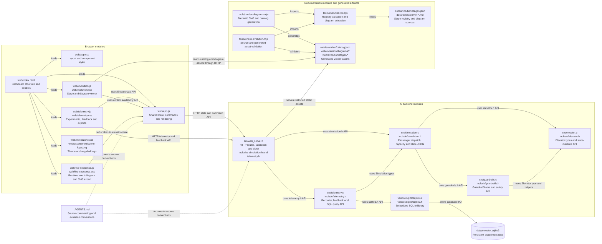
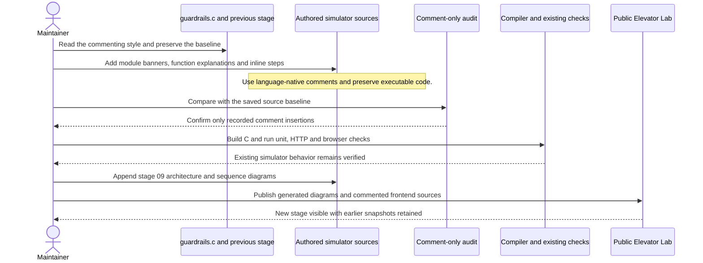

# Consistent source-code comments

Stage 08 preserves the Metriczone visual identity and the system's existing behavior. This stage applies the commenting conventions demonstrated in `src/guardrails.c` to the authored web simulator code: module banners, descriptive function blocks, and inline explanations of validation, state changes, persistence and cleanup. PowerShell, HTML, CSS and build configuration use their own comment syntax with the same explanatory style.

## Architecture

## Sequence: annotate and verify without changing behavior

The original `src/guardrails.c`, original elevator core, reference implementation and third-party SQLite distribution are not annotated by this change. Binary logo assets and machine-readable JSON remain in their native formats. Generated diagram files are regenerated from the documented sources rather than edited by hand. Comments describe the existing implementation, including failure cases and practical limits; they do not introduce new runtime behavior or a new deployment model.
