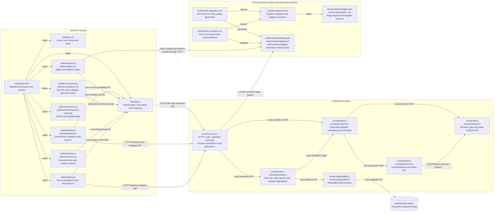
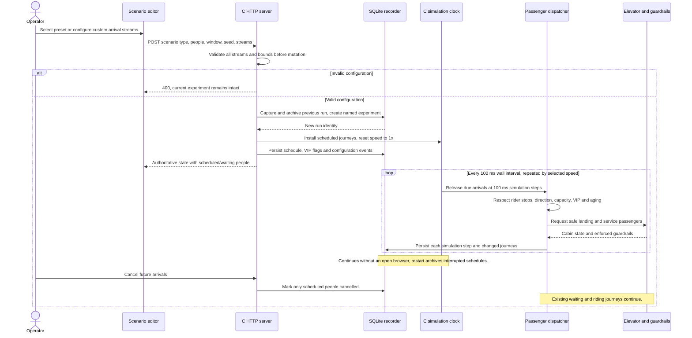
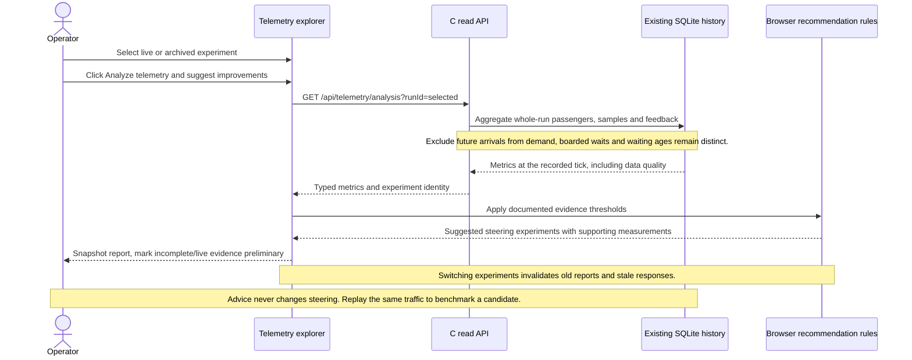

# Repeatable traffic, explainable steering advice

Stage 09 is the preserved baseline: the Metriczone browser operates a C simulation,
SQLite records experiments, and a generated catalog exposes evolution diagrams.
This stage adds runnable usage scenarios and a dedicated analysis action.

## What changed and why

- **Busy morning:** 300 people by default, evenly arriving over 600 simulation seconds,
  travelling from floor 0 to seeded destinations on floors 1–9.
- **Busy afternoon:** 300 people over 600 seconds, from seeded office floors to floor 0.
- **Occasional travellers:** 24 mixed-floor journeys over 1,200 seconds.
- **VIPs:** 40 mixed-floor journeys over 300 seconds, every fifth person is a VIP.
- **Custom:** up to 20 streams specify origin, destination, people, first arrival,
  interarrival seconds and VIP status. Interval zero creates a simultaneous group.
  Each run supports up to 1,000 people, with arrivals within 86,400 seconds.
- Presets expose people, arrival window and seed. The seeded integer generator makes
  routes repeatable. Arrivals are evenly spaced, not a stochastic arrival model.
  Custom routes and times are explicit, its seed is retained but does not change them.
- Scenario configuration is validated before archiving the current experiment.
  New runs reset to floor 1 and 1× speed. Previous telemetry and feedback remain,
  unfinished previous journeys, including future arrivals, become cancelled.
- The C clock releases scheduled arrivals independently of browsers. The eight-seat
  cabin and original elevator/guardrail modules remain. Empty cabins prioritize VIP
  pickups, compatible boarding also prioritizes VIPs. A 120-second-old waiting person
  outranks new VIPs, with oldest arrival and passenger ID breaking ties. Priority is
  a preference at dispatch/service boundaries, not a guaranteed wait deadline or an
  exclusive VIP cabin, occupied cabins keep serving rider destinations.
- Server-side 1×/5×/20× speed preserves 100 ms simulation steps and records each step.
  Wall-clock timestamps accelerate relative to simulation time. Cancel future arrivals
  leaves existing waiting/riding people active. Schedules live in C memory, restarting
  archives interrupted runs and does not resume their schedules.
- The dedicated **Analyze telemetry & suggest improvements** button queries the whole
  selected live or archived experiment. SQL computes wait mean/p95/max, waiting age,
  VIP/regular mean waits, ride mean, lobby flows, peak queue, motion occupancy, empty
  and full travel fractions, emergency stops, guardrail violations and recording gaps.
  Future arrivals do not count as released demand. Wait percentiles use boarded
  passengers only, with nearest-rank p95, unfinished waits are shown separately.
- Browser rules explain evidence and thresholds for morning lobby return, afternoon
  demand scoring, earlier aging, destination batching, idle positioning and bounded
  VIP priority. Low evidence, recording gaps, stops and feedback are also identified.
  These are hypotheses, not benchmarked improvements, AI inference or automatic tuning.
  Reports are explicit snapshots, re-analysis refreshes them. Table filters do not apply.
- SQLite schema 3 adds a default-zero VIP column in place and retains historical rows.
  Journey status supports scheduled/cancelled, no boarding timestamp is written for
  people who never boarded. Scenario parameters and custom streams are retained in
  durable run events. The live journey table shows at most 100 matching rows, paged
  telemetry remains available. Tick-filtered journey queries select by added tick,
  so future scheduled rows appear only when the requested range includes their tick.

## Architecture

## Sequence: start and run reproducible traffic

## Sequence: analyze evidence and propose an experiment

The existing persistent database location, public tunnel, allowed hosts, listen address,
and prior stage IDs remain unchanged. New assets are served by the C backend.
Architecture, sequences, SVG and Mermaid downloads are published through the existing
catalog-driven viewer, there is no second hardcoded timeline.
