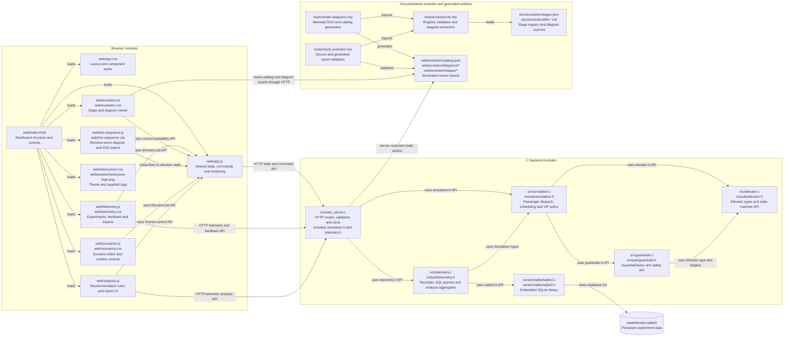
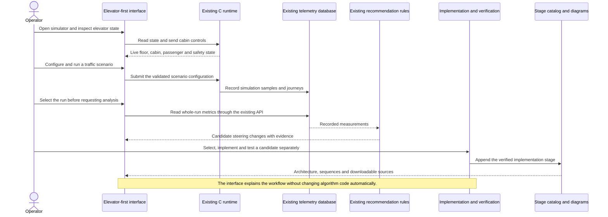

# Elevator-first interface and direct language

Stage 10 is the preserved baseline: the simulator supports scheduled traffic scenarios,
VIP and age-based priority, persistent telemetry, and rule-based steering recommendations.
Its page places the scenario editor before the live elevator and uses promotional headings.

## What changed and why

- The page now presents the live elevator and cabin controls first, followed by traffic
  scenarios, telemetry and algorithm analysis, passenger records and activity, live
  interaction sequences, and system evolution. This is the actual HTML order, including
  keyboard and screen-reader navigation. Cabin controls precede manual passenger input.
- The sidebar follows the same task order. Compact links to Elevator, Scenarios and
  Telemetry & analysis remain available when the sidebar collapses on smaller screens.
  Diagram shortcuts appear with the secondary diagnostics instead of preceding the elevator.
- The title is **Elevator simulator**. Headings, empty states, feedback prompts and
  command messages describe their purpose directly. Marketing slogans and decorative
  captions are removed. The existing logo, colors and available controls are retained.
- The interface describes the autoevolution workflow: run traffic scenarios, analyze
  telemetry, test steering changes and document each implementation stage. Telemetry
  analysis suggests candidates. Algorithm changes are implemented and tested separately,
  with new runs and evolution snapshots. The page does not claim autonomous algorithm
  editing, benchmarking or deployment.
- In telemetry, the experiment selector precedes its metrics and analysis action, so
  the selected run is clear before recommendations are requested. Existing full-run
  scope, snapshot reports and table filters retain their behavior.
- A smaller header and logo give more space to the live elevator. All existing section
  IDs, forms, runtime controls, scenario inputs, export formats and diagram downloads
  remain available. The C backend, steering policies, database, public tunnel and network
  settings are unchanged. The running server reads the revised static assets directly,
  so deployment does not require restarting the simulation.

## Architecture

## Sequence: operate, analyze and evaluate a change

Earlier stage notes and IDs remain historical snapshots. The new diagrams and stage
notes are generated into the existing catalog-driven web and offline viewers.
