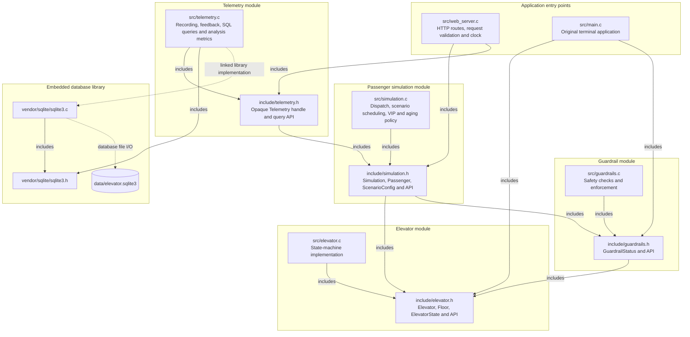
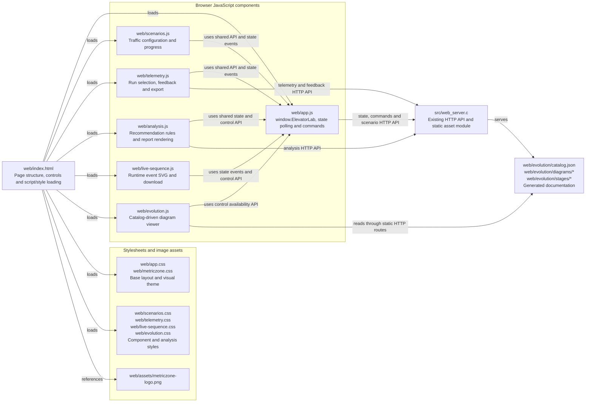
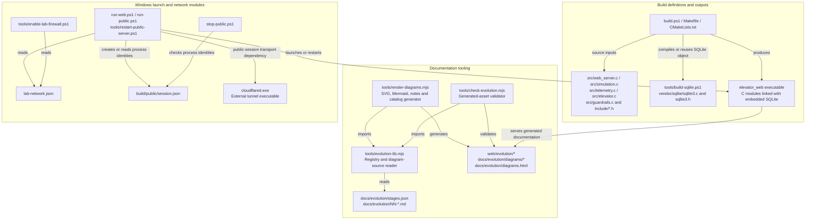
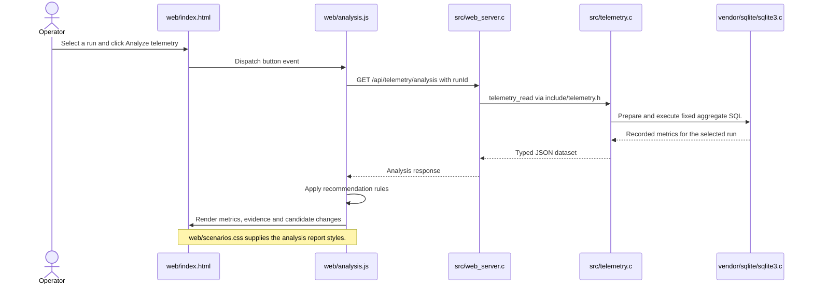

# Module-based architecture diagrams

Stage 11 is the baseline: an elevator-first interface, scheduled traffic scenarios,
SQLite telemetry and rule-based steering recommendations. This stage changes the
architecture documentation to describe software structure at the file and module level.

## What changed and why

- Architecture diagrams identify actual implementation modules: C files and their
  public headers, HTML/JavaScript/CSS components, documentation tools and deployment
  configuration. Labeled edges describe includes, shared APIs, HTTP dependencies,
  asset loading, generation or process ownership.
- The architecture diagrams for stages 01–11 are revised to show the modules available
  at each historical stage. This is a correction to their representation, not a change
  to the systems those stages describe. No later module is added to an earlier stage.
  Stage IDs, historical behavior, notes outside the architecture sections and sequence
  diagram sources are preserved. Earlier themes remain stage-specific.
- The current source architecture is separated into C, web, and tooling/deployment
  views below. Each box represents a real source file, header, grouped component or
  clearly named generated artifact. There are no decision branches or numbered tasks.
- Mermaid `flowchart` remains the supported rendering syntax for module/dependency
  graphs. It does not imply an execution flow. Sequence diagrams continue to explain
  ordering, calls and interactions.
- `AGENTS.md` records this distinction for future implementation stages. The existing
  renderer, generated catalog, SVG/Mermaid downloads and offline gallery publish the
  updated views. The documentation pipeline itself does not change behavior.
- The simulator, algorithm, database schema, running C process, public tunnel and
  network configuration are unchanged. Static documentation updates require no restart.

## Architecture: C files, public headers and include dependencies

Solid arrows point from an including file to its header. Labeled dotted edges show
library linkage or data-file ownership. Public APIs and shared types are declared
in headers, and their implementations reside in the matching C files.

## Architecture: HTML, JavaScript and CSS module dependencies

The scripts use a shared `window.ElevatorLab` interface and `elevator-state` events,
not ES module imports. Analysis report styles are defined in `web/scenarios.css`.
HTTP edges represent component dependencies on existing server APIs.

## Architecture: documentation, build and deployment modules

These relationships describe tool imports, file inputs/outputs, build linkage and
process configuration. The scripts and renderer are not modules of the running
C simulation. `cloudflared.exe` is an external executable, not authored source.

## Sequence: analysis across the actual implementation modules

The architecture relationships can be checked against source includes, HTML asset
references, JavaScript shared API usage and build/script inputs. Generated SVGs and
Mermaid sources remain available from the public evolution viewer and offline gallery.
