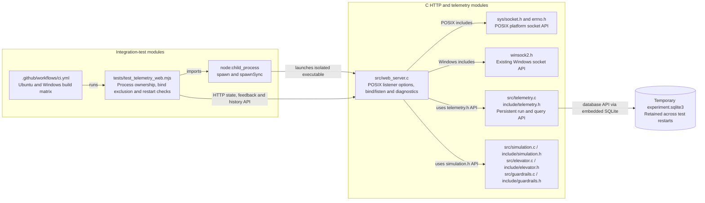
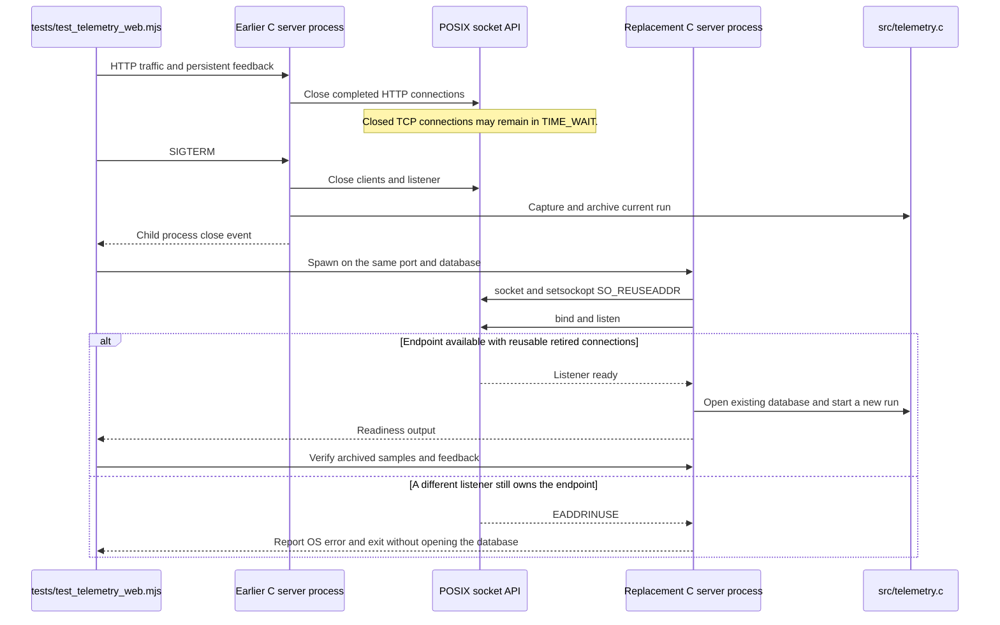

# Restart-safe POSIX HTTP listener

Stage 12 is the baseline: the C HTTP server embeds SQLite, and the telemetry HTTP
integration test stops and restarts the server on the same address and database.
On Ubuntu, the second bind can fail even though the earlier process has exited.

## What changed and why

- Reproduced the reported failure on Ubuntu under WSL with Linux Node.js 22.23.3:
  `tests/test_telemetry_web.mjs` failed at the same-port restart with
  `Cannot bind 127.0.0.1:18093`. This is a listener configuration issue rather than
  a Node version mismatch or an unawaited server shutdown.
- `src/web_server.c` sets `SO_REUSEADDR` before `bind()` on POSIX systems. This permits
  a replacement listener to reuse its endpoint while earlier closed connections
  remain in `TIME_WAIT`. `SO_REUSEPORT` is not enabled. An active listener on the same
  address and port still prevents another instance from starting.
- The Windows socket-option policy is unchanged. Shared startup diagnostics now
  distinguish socket-option, bind and listen failures, including the actual POSIX
  error text or Windows socket error code before closing the failed socket.
- The telemetry integration test captures its child-process close promise at spawn
  time, handles spawn failures and signal-based exits, and awaits complete shutdown.
  It exercises three immediate same-port/same-database restarts after real HTTP
  traffic, verifies archived feedback and sample counts, and rejects a competing
  listener. Archived sample counts are read after the run is closed so later live
  ticks cannot invalidate the expected result.
- The existing `.github/workflows/ci.yml` already runs this test on Ubuntu and Windows,
  so both targets receive the regression checks without a workflow change. No retries,
  fixed sleeps or alternate ports hide the server-side bind failure.
- The original elevator core, guardrails, simulation policies, database schema and
  public network configuration are preserved. The new stage is published through
  the existing generated web catalog. The running Windows service and tunnel need
  no restart to serve the documentation update.

On Linux, both the previous and replacement listener must have `SO_REUSEADDR` enabled.
Connections left by an older unpatched binary can still require `TIME_WAIT` expiry
before the first patched launch. Subsequent patched restarts use the new policy.
See the [Linux socket manual](https://man7.org/linux/man-pages/man7/socket.7.html),
including its `SO_REUSEADDR` description and port-reuse notes.

## Architecture: listener implementation and regression-test modules

## Sequence: close and immediately restart the same POSIX endpoint

The source remains a single HTTP-server module. No new C file, header interface,
external database or runtime dependency is introduced.
